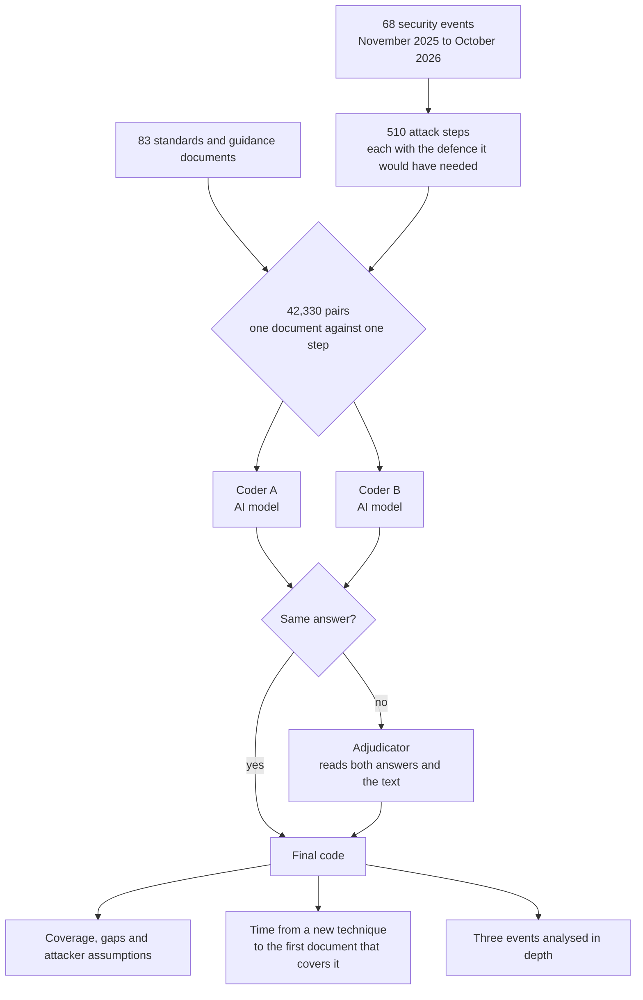
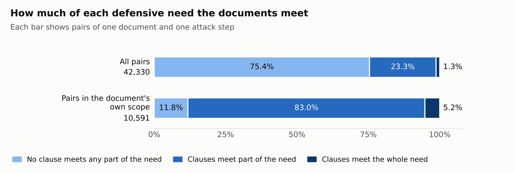
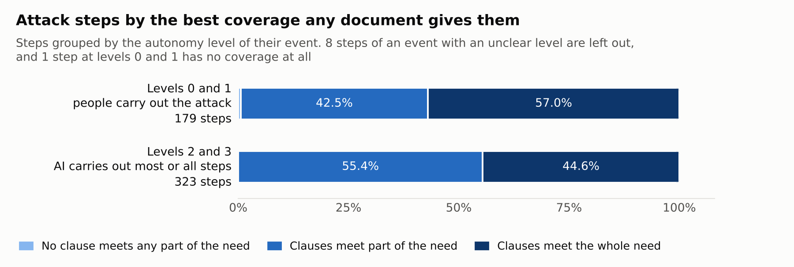
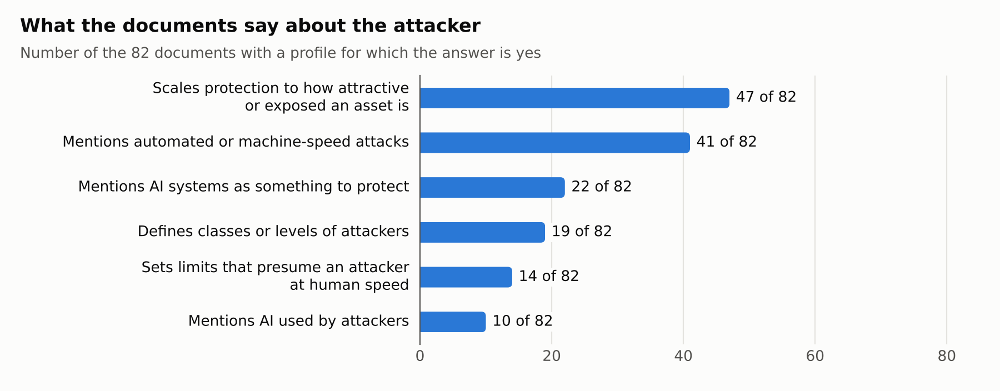
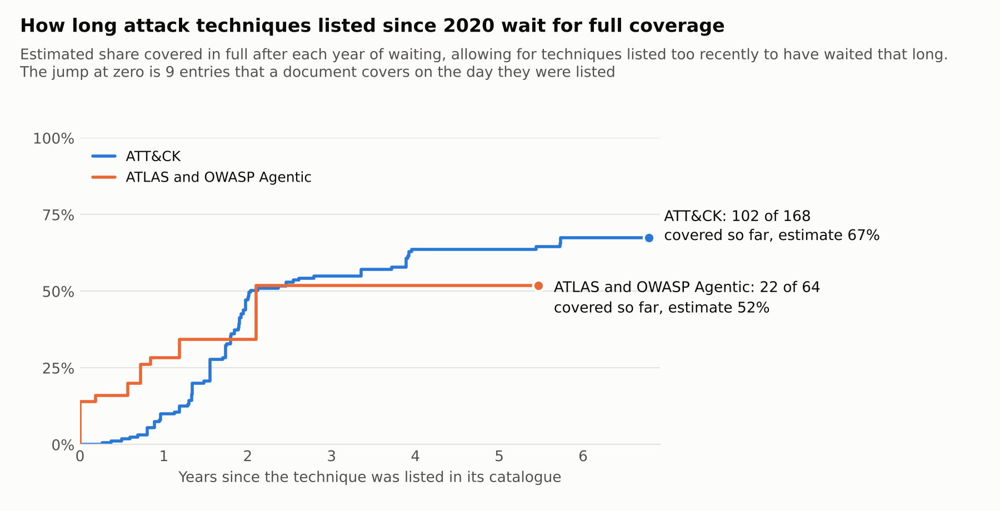
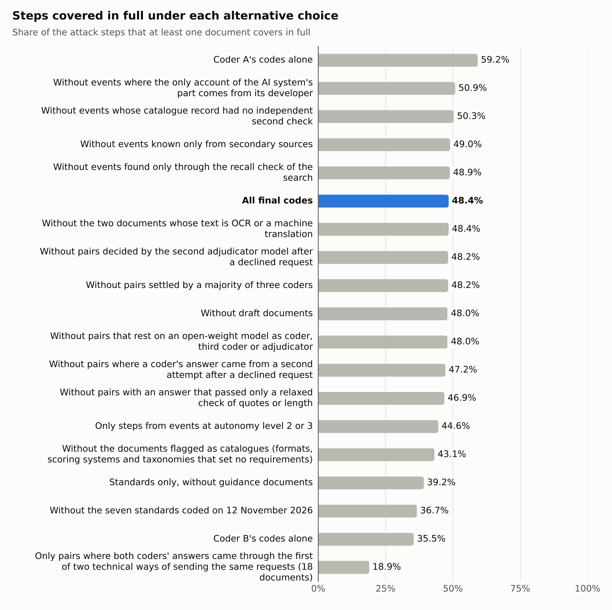

# How far security standards for smart city infrastructure cover the steps of AI-related security events

Data and method for a study by Roar Georgsen, University of South-Eastern Norway (USN), prepared for a doctoral trial lecture on 13 November 2026 and for a journal article that follows it. This repository is the supplementary material of that article. It holds the tables behind the main numbers of the study, the definitions used to classify the documents and a script that recomputes the main figures.

## Introduction

A city runs on technical systems that most residents never see: traffic signals, water and wastewater plants, building controls, street lighting, sensors, the networks that connect them and the data platforms that collect what they measure. This study calls them smart city infrastructure. When one of these systems has a weakness that an attacker can use, the weakness is a security vulnerability.

Organisations that build and run such systems rarely invent their security measures from nothing. They follow standards, which are documents that state what a system or an organisation shall or should do. Standards come from bodies such as the International Organization for Standardization (ISO), the International Electrotechnical Commission (IEC), the European Telecommunications Standards Institute (ETSI) and the Institute of Electrical and Electronics Engineers (IEEE). Beside them stands guidance from public authorities such as the National Institute of Standards and Technology (NIST) in the United States, the European Union Agency for Cybersecurity (ENISA) and the Norwegian National Security Authority (NSM). What these documents require is, for most organisations, the working definition of good practice. The study was given this question to answer: what is the state of practice on system security vulnerabilities of smart city infrastructure, as documented in standards?

A list of what the documents say would answer the question only on paper. The study therefore tests the documents against what attackers did. It takes security events that were publicly reported between 1 November 2025 and 31 October 2026 (two of them first surfaced a little earlier and were reported again in this period, and one campaign continued with a second wave on 1 and 2 November 2026), breaks each into the single steps of the attack, and asks of every document and every step whether the document states a measure that would have met it.

Few of these events struck city infrastructure itself. Eleven of the 68 name an energy, water, utility, building or municipal sector, and most of the others hit cloud services, software supply chains, AI services, companies and government offices. The study uses them because they show what attackers working with artificial intelligence (AI) did in the period, and it asks whether the documents written for smart city infrastructure would have met the same steps.

The events were chosen because an AI system had a part in them. In some a person used an AI system as a tool. In others an AI system carried out most of the attack while a person approved its actions, or chose and carried out the steps with nobody directing it. In 21 events an AI system did harm on its own while doing an ordinary task, with no attacker behind it, and in 17 the AI system was itself the thing attacked. This matters for standards because a security measure is always written with some attacker in mind. A rule that locks an account after five wrong passwords assumes an attacker who types at human speed, and a risk method that spends less protection on an unattractive target assumes an attacker who has to choose targets because time and skill are scarce. An AI system that works at machine speed and at low cost can break such assumptions. The study asks three things:

1. What do current standards document about the security of smart city infrastructure, and what attacker do they assume?
2. Which of the observed attack steps fall inside, partly inside or outside what the standards require?
3. Where a standard falls short, why does it, and how long after a new attack technique appears does a standard cover it?

The repository does not contain the standards themselves. Most are sold under licence, so the tables here name clauses by their numbers, and no single quote is longer than 25 words. A clause is a numbered passage of a standard, such as a requirement, a control or a row of a table.

## Methodology

The diagram shows the path from documents and events to results. The terms in it are explained in the sections that follow.



### The documents

The corpus, which is the set of documents the study reads, holds 83 documents: 62 standards and 21 guidance documents (`data/documents.csv`). A document entered when it met five conditions. It is a standard, technical specification or technical report from a standards body, a technical publication from a government body that sets requirements or recommendations, or a guidance document. It addresses the security of at least one layer of smart city infrastructure (field devices, networks and protocols, platforms and data, applications and services, operations and governance) or the handling of vulnerabilities in such systems. It is the edition in force on 1 November 2026, or a public draft of its successor, which is marked as a draft. Its full text was available to the researcher. And it is not a technical duplicate of another document in the corpus. Guidance documents and two NIST drafts on AI security that the search for events turned up were added by the researcher's decision. Two of the 21 guidance documents do not come from public authorities: one is from OWASP, a community body for software security, and one from MITRE, a not-for-profit research organisation.

Seven of the 83 are central standards whose full text the researcher obtained on 12 November 2026, after the first results for the other 76 documents were known: ISO/IEC 27001, ISO/IEC 27002, ISO/IEC 27005 and four parts of IEC 62443 (parts 2-1, 3-3, 4-1 and 4-2). They were coded by the same procedure. Results that are already known can influence which documents a researcher adds, so the column `coded_on_12_november` marks the seven and one row of `data/sensitivity.csv` gives the results without them.

Some central standards are missing because their full text could not be obtained: the other parts of the IEC 62443 series, IEC 62351, ISO/IEC 27400, 27402, 29147 and 30111, ISO 37106, ISO/IEC 30145, ISO 19650-5, ISO/SAE 21434, IEEE 1609.2, KNX, BACnet and ISO/IEC 27090:2026. The results describe the 83 documents coded and not security standards in general.

### The events and their attack steps

A structured search of academic and non-academic sources, called a multivocal literature review (Garousi, Felderer and Mäntylä, 2019), catalogued 569 security events and demonstrations of what AI systems can do: 402 from the twelve months of the study with a reported AI role, 146 earlier ones from January 2024 to October 2025, and 21 control events with no reported AI involvement. For 68 events from the twelve months of the study the public sources described the course of events well enough to divide it into steps (`data/events.csv`). Three of the 68 are control events: attacks on infrastructure from the same period with no reported AI involvement, kept for comparison.

Each event has an autonomy level, which says how much of the attack an AI system carried out:

| Level | Meaning |
|---|---|
| 0 | No AI system took part in carrying out the event. This covers the three control events and seven events in which an AI system was the target and did not carry out the attack |
| 1 | People carry out the attack and an AI system helps them |
| 2 | An AI system carries out most steps and a person approves them |
| 3 | An AI system chooses and carries out the steps, and no person directs it after it starts. This includes AI systems that caused harm with no attacker behind them |
| unclear | The sources do not settle the level. This applies to one event with eight steps, which is left out of comparisons between levels |

The 68 events gave 510 attack steps (`data/attack_steps.csv`). A step is one action by the attacker, or one condition the attacker relied on, described at the level of detail of the public catalogues of attack techniques: MITRE ATT&CK (MITRE, 2026a), MITRE ATLAS, its counterpart for attacks on AI systems (MITRE, 2026b), and the OWASP Top 10 for Agentic Applications (OWASP, 2025). Each step also states, in one sentence, what a defender would have had to do to prevent it, detect it, limit its effect or respond to it. The study calls this sentence the defensive need (`defensive_need`), and it is what the documents are judged against.

Every step was written by an AI model from the saved text of the public sources. A second model then checked each step against the passage it rests on. It accepted 282 steps as written. Of the others, 144 were revised and 84 were kept as they were against the checker's objection, each with a recorded reason. The column `check_still_asked_for_revision` marks the 73 steps for which a second check still asked for a change.

### Judging one document against one step

The unit of the analysis is a pair: one document set against one step. 83 documents and 510 steps give 42,330 pairs (`data/coverage.csv`). The method follows the way NIST maps one document to another (Scarfone, Souppaya and Fagan, 2024).

Assigning one value from a fixed list to an item is called coding. The value is a code, whoever assigns it is a coder, and the list with its definitions is the codebook (`method/codebook.md`). For each pair the coder answers a fixed list of questions with one code each. A pair whose final coverage is full is called a full code below.

**Is the step inside the document's own scope?** A standard for traffic signal controllers does not claim to cover a cloud database. The pair is in scope (`scope_match` is `yes`) when the document itself states that it covers the kind of asset or activity that the defence would protect.

**How much of the defensive need do the document's clauses meet?** This is the coverage (`coverage`). It is full (`full`) when one clause, or several together, state measures that meet the whole need. It is partial (`partial`) when clauses meet part of the need, or meet it only in general terms such as "manage risks to systems", or meet it only under an assumption that the step broke. It is none (`none`) when no clause meets any part of it. The coder must name each clause and copy the supporting words from the document (`data/clause_evidence.csv`). Two rules shape the counts. Where two coverage levels were about equally defensible, the coder was told to choose the higher one and to mark its confidence as low, so doubtful cases count in favour of the document. Of the 551 full codes, 117 carry low confidence. And a general clause on input checking, access control or the supply chain counts as partial at most for a step against an AI system, unless it names AI inputs, models, agents or their tools.

**How binding are those clauses?** The normative force (`normative_force`) is a requirement (shall, must), a recommendation (should, may) or informative text (notes and examples).

**Did the step break something the clause takes for granted?** The broken assumption (`assumption_violated`) records it. The list covers what a clause may assume about the attacker (limited skill, limited money and effort, a need to choose attractive targets, human working speed, fear of being identified), about time (that defenders have days where the step took hours), and about the system (that a person reviews an action before it takes effect, that an approved supplier stays trustworthy, that the component involved lies inside the system the clause governs).

**Why does the document fall short?** Where coverage is partial or none, the gap class (`gap_class`) gives the main reason:

| Gap class | The document falls short because |
|---|---|
| Scope (`scope`) | it states no measure for the step, or none for part of the need |
| Attacker model (`attacker_model`) | its protection depends on who the attacker is, and the step broke that assumption |
| Tempo (`tempo`) | it addresses the activity, but allows the defender more time than the attack took |
| Technical assumption (`technical_assumption`) | it depends on a property of the system, such as human review, that did not hold |
| Infrastructure (`infrastructure`) | it depends on shared vulnerability services, such as public vulnerability databases, that were degraded |
| Accountability and supply chain (`accountability_supply_chain`) | the step used a component, supplier or tool for which the document gives no party a duty |
| Very small entities (`vse_applicability`) | a clause meets the need only through resources that a very small organisation lacks |

### Two AI coders and an adjudicator

Reading 83 documents against 510 steps is beyond what one person can do by hand in the time available, so the coding was done by large language models, which are AI systems that read and write text. Two models coded every pair independently, each without seeing the other's answer: `claude-sonnet-5-5` as coder A and `claude-opus-4-8` as coder B, both from Anthropic. Each request held the full text of one document, at most 20 steps and the same fixed instructions (`method/coder_instructions.md`).

Where the two coders gave the same coverage, the same answer on scope and the same gap class, coder B's answer became the final code, with its clauses and quotes. The other answers, such as normative force and broken assumption, were not compared. Where the coders differed on one of the three, or a program found an answer inconsistent with the rules of the codebook, a third request to `claude-opus-4-8` received both answers and the document and decided. The study calls this third request the adjudicator. For five pairs only one coder's answer exists. The column `settled_by` in `data/coverage.csv` says which of these routes produced each final code.

Language models can invent text. Every quoted clause was therefore compared by program with the document, character for character, and an answer whose quote was not in the document was rejected and asked for again.

Anthropic's models declined some requests because the material describes attacks, although the task was defensive and asked for no attack instructions. Those requests were completed by other models: Kimi K3 and GLM-5.3, which are open-weight models, meaning that their makers publish them for anyone to run, and for some adjudicator decisions `claude-fable-5-2`. Where three models coded a pair and two agreed, the majority decided.

Each coder also filled in an attacker profile for every document (`data/attacker_profiles.csv`): six yes or no questions on whether the document defines classes of attacker, scales protection to how attractive a target is, sets limits that presume human speed, mentions automated attacks, mentions AI as an attacker and mentions AI systems as something to protect. Of the 82 final profiles, 40 are ones the two coders agreed on, 26 were settled by the adjudicator and 16 rest on one coder, because the other coder's profile is missing. One document has no final profile.

For every full code, Kimi K3 and GLM-5.3 were asked what each cited clause does against the step (prevent, detect, limit, respond or nothing) and whether the clauses together would have stopped it (`data/full_code_functions.csv`). The two models saw the step, the quoted words of the clauses and the coder's reason, but not the standard itself. A full code counts as stopping its step when every model that gave a valid answer says so.

### How far the coding can be trusted

Two coders who agree by chance alone prove nothing, so agreement is reported as Krippendorff's alpha (Krippendorff, 2018). Alpha is 1 when two coders always agree and 0 when they agree no more often than chance would produce. By convention 0.80 counts as reliable and values from 0.667 to 0.80 as good enough for tentative conclusions only (`data/agreement.csv`).

The researcher reviewed 100 final codes and agreed with all 100. The sample was drawn at random in four groups of 25: codes rated full, codes rated partial, codes rated none where the step was in scope, and codes the adjudicator had decided. 68 of the 100 came from steps at autonomy level 2 or 3. Pairs rated none outside the document's scope, which are most pairs, had no group of their own, and eight of them entered through the group of adjudicated codes. One code drawn as full had become partial by the time of the review. The sample holds no code of the seven standards coded on 12 November. He saw each code before judging it, which makes this an upper bound on the true agreement.

`data/sensitivity.csv` repeats the count of steps covered in full under 18 alternative choices, such as one coder alone, standards without guidance documents, or without the pairs that another model had to complete. This shows how far the result depends on choices the study made.

### Time to coverage

The catalogues of attack techniques record when each technique was first listed. For every technique in the 510 steps that was listed from 2020 onwards, the study measures the time from that date to the publication of the first corpus document that covers a step using the technique in full (`data/time_to_coverage.csv`). A technique that no document covers by 31 October 2026 is counted as still waiting, and the typical wait is estimated by the Kaplan-Meier method (Kaplan and Meier, 1958), which is built for data where some waits have not ended.

### Three events in depth

Three events were analysed with CAST, a method from systems engineering for the study of accidents (Leveson, 2011). It draws who controlled what in the system where the event happened, from the technical controls up to management and regulators, and then asks which control was missing or inadequate. The study placed the coded clauses on that drawing to see which party the standards address. The findings are summarised below.

### Changes made during the study

The method was written down and fixed before the coding began. Besides the seven standards coded on 12 November (see the section on the documents), these changes to models, definitions, instructions and code were made afterwards:

| Change | Reason |
|---|---|
| For six documents both coders ran on `claude-opus-4-8` | Coder A's model had declined requests, and the arrangement was reversed for the remaining documents once it proved unnecessary |
| The quote check accepts a quote that is interrupted by a table's row label, by a page header or footer, or by a page break | Extracted text from tables and page breaks split quotes that were present in the document |
| Quotes and written reasons are accepted up to 100 words, where the instructions ask for 40 and 60 | Otherwise correct answers were being rejected for length |
| A separate instruction text for the adjudicator of attacker profiles | The fixed method lacked one |
| Declined requests go to `claude-fable-5-2` with a stated defensive purpose, to Kimi K3 as coder, and to GLM-5.3 as third coder with a majority rule | Safety filters declined part of the defensive coding |
| The function of the clauses behind each full code is coded | Added after the first results, to separate clauses that would stop a step from clauses that only relate to it |
| Time to coverage counts full coverage by a document published on or after the technique was listed | Under the original definition (full or partial coverage by any current edition) nearly every technique counted as covered at once, which said nothing. This was chosen after the first results, and the original result is in `data/time_to_coverage.csv` beside it |
| The steps of one event (C-001, in which AI agents under evaluation at OpenAI broke into the systems of Hugging Face) were corrected from an independent investigation and the affected organisation's own account, and three of them were coded again | The first version rested on the report of the developer whose AI system caused the event |

### Use of AI tools

AI models did the coding, as described above. They also wrote the attack steps from the public sources, assessed candidate documents for the corpus, wrote the program code and drafted the texts of this repository, under the researcher's direction and with his decisions at each stage. The researcher designed the study, approved the corpus, ruled on doubtful cases, reviewed a sample of the final codes and is responsible for the content.

## Results summary

**Full coverage is rare, and most pairs lie outside the document's own scope.** Of the 42,330 pairs, 551 (1.30%) have full coverage, 9,859 (23.29%) partial and 31,920 (75.41%) none. A low share of pairs is expected, because every step is set against every document, and most documents deal with another kind of system than the one a given step struck. Only 10,591 pairs (25.02%) are in scope, and among those 550 are full, 8,791 partial and 1,250 none.



**Just under half of the steps are covered in full by at least one document.** That holds for 247 of the 510 steps (48.43%). The count falls to 200 when the clauses must also stop the step in the judgement of two further models, to 200 with standards alone, and to 81 when the clause must be a requirement. Of the 247 steps, 120 rest on a single document. More than half of the documents (52 of 83) have no full code at all. Without the seven standards coded on 12 November the counts are 187 steps covered in full, 146 where the clauses also stop the step, 102 with standards alone and 48 with a requirement. Most of the difference in the first three comes from one document, ISO/IEC 27002, which alone has 135 of the 551 full codes, all of them recommendations. The difference in the fourth comes from ISO/IEC 27001: 32 of the 81 steps have a requirement only in its Annex A, whose controls an organisation may leave out with a justification.

**Steps from events at the higher autonomy levels are covered less often.** Some document covers in full 144 of the 323 steps (44.58%) from events at autonomy levels 2 and 3, against 102 of 179 (56.98%) at levels 0 and 1. Eight steps come from the one event whose level the sources leave unclear and are in neither group. The difference remains when the steps of AI systems that acted with no attacker behind them are left out: 95 of 198 steps (47.98%) against 102 of 178 (57.30%). It is a description and not proof that the AI system is the reason: the two groups of events differ in more than who ran the attack, and with coder A's codes alone the difference shrinks to under three percentage points (58.8% against 61.5%).



**Most documents define no attacker.** Of the 82 documents with a profile, 63 define no classes of attacker and 10 mention AI as an attacker. Yet 47 scale protection to how attractive or exposed an asset is, which is an assumption about the attacker that an AI system could break.



**Nearly every shortfall is recorded as a matter of scope.** Among the 10,041 in-scope pairs rated partial or none, 9,750 (97.10%) have the gap class scope: the document states no measure for the step or for part of the need. The classes that would show a broken assumption are small. The table counts all 41,779 pairs rated partial or none, in scope or not.

| Gap class | Pairs | Steps touched (of 510) |
|---|---|---|
| Scope | 41,460 | 510 |
| Accountability and supply chain | 194 | 25 |
| Technical assumption | 48 | 21 |
| Attacker model | 43 | 36 |
| Tempo | 34 | 30 |
| Infrastructure | 0 | 0 |
| Very small entities | 0 | 0 |

The small counts do not show that the standards' assumptions hold. The coders agree poorly on which of these classes a pair belongs to, and scope is a broad class that says little about why a measure is missing. The assumption recorded as broken most often concerns suppliers and components (174 pairs), and not the attacker (13 pairs).

**Techniques listed since 2020 wait about two years for full coverage, and many still wait.** The steps use 168 ATT&CK techniques that the catalogue listed in 2020 or later. A corpus document published on or after the listing date covers 102 of them in full. The estimated median wait is 2.0 years, which is the time by which half of the techniques are expected to be covered when those still waiting are taken into account. For the 64 techniques against AI systems (from ATLAS and the OWASP list) the count is 22 and the estimated median 2.1 years. Nine of the 22 are entries of the OWASP list that the OWASP document itself, which is both a catalogue and a corpus document, covers on the day of listing. When the covering clause must be a requirement, the counts are 45 and 2 and no median is reached. Where the clauses must also stop the step, the median for ATT&CK is 5.7 years and none is reached for the techniques against AI systems. The measure depends strongly on which documents are in the corpus: without the seven standards coded on 12 November the medians under the first definition were 5.4 and 4.6 years. A listing date in 2020 does not always mean a new kind of attack. Of the 168 ATT&CK techniques, 125 are dated 2020, 80 of them sub-techniques, which are narrower variants of a technique, and ATT&CK reorganised its catalogue into sub-techniques in that year (MITRE, 2020), so many of these entries describe behaviour that was known before.



**The coded requirements sit with the organisation that owns the asset.** In all three events analysed in depth, the clauses the coders cited address the owner or operator, in two of the three mostly at its automated technical controls. No clause was coded for platform operators or authorities, and the clauses coded for AI providers are partial with one exception. This follows in part from the design, because each defensive need was worded for the asset owner.

- *A campaign by a self-described autonomous agent against the automated pipelines that build software (level 3).* Its eight steps have two full codes. The requirements reach the owner of the software as general principles, such as giving each account no more rights than its task needs, that name no build pipeline.
- *Manipulation of internet-exposed industrial controllers in US infrastructure (control event, no AI).* Every one of its seven steps has at least three full codes, so the known controls for this well-understood attack are in the documents. For the step that locked the operators out, the two further models judged that none of the four full codes would have stopped it.
- *An intrusion at government bodies and a water utility in Mexico, run by an operator through AI coding tools (level 2).* Its ten steps have 26 full codes between them, 15 of them for the two steps at the boundary between office and industrial networks: separating the networks, and protecting the login of the industrial gateway. Two steps have no full code. One guidance document covers in full the step in which the operator planted lasting instructions in the AI tool. Every other measure on the AI tool or its provider is partial.

**The results are tentative.** The coders agree on coverage with alpha 0.76 and on scope with 0.77, inside the band for tentative conclusions and below the 0.80 that counts as reliable. On the gap class alpha is 0.40, too low to trust the placing of single pairs. With coder A alone 302 steps are covered in full (59.2%) and with coder B alone 181 (35.5%), against 247 in the final codes. The figure also falls when documents are left out: to 43.1% without the twelve documents that only define formats, scoring systems and taxonomies, to 39.2% with standards alone and to 36.7% without the seven standards coded on 12 November. Two rows of the table are subsets and not alternatives: the steps at levels 2 and 3 alone (44.6%) and the 18 documents whose requests were sent in the first of two technical ways (18.9%). In the eleven other variations, which leave out events, single pairs, the three drafts or the two documents with a poorer text, it stays between 46.9% and 50.9%.



## Limits

- The two main coders come from one family of models, and the adjudicator is the same model as coder B.
- The corpus holds only documents whose full text was available. Central standards are missing (see the list above).
- Seven standards were coded after the first results were known. Their codes are not independent of each other: Annex A of ISO/IEC 27001 restates the controls of ISO/IEC 27002 as requirements that an organisation may leave out with a justification, and the four IEC 62443 parts belong to one series and refer to each other. The copy of ISO/IEC 27001:2022 lacks Amendment 1:2024.
- IEC 62443-3-3 was coded from an English machine translation of its Spanish edition, so its quotes are not the wording of the standard. ISO/IEC 27005 was read by optical character recognition (`text_obtained_as` in `data/documents.csv`).
- Accounts of what an AI system did often rest on few parties, in some events on the developer of the system alone. For event C-001 the steps follow an independent investigation and the affected organisation's own account where these describe the step, and details that only the developer reports are kept in the developer's wording. The column `source_note` names the kind of source behind each of its steps. The sources describe further actions in that event that the study does not code, and the study did not look for further independent accounts of the other events.
- Two further events have no steps because the AI model declined to write them.
- The defensive needs were worded for the asset owner, so the study did not test what standards require of authorities, platforms and AI providers.
- The definition of time to coverage was chosen after the first results were seen. It counts only the documents of the corpus and only current editions, without the three drafts. An earlier edition or a document outside the corpus may have covered a technique sooner.

## Files

| File | Rows | Content |
|---|---|---|
| `data/documents.csv` | 83 | The documents: title, edition, date, issuer, class, layers, how the text was obtained |
| `data/events.csv` | 68 | The events: name, dates, autonomy level, AI roles, sectors, links to the public sources |
| `data/attack_steps.csv` | 510 | The steps: description, defensive need, technique labels, who performed the step, source link |
| `data/coverage.csv` | 42,330 | The final code of every pair |
| `data/clause_evidence.csv` | one per cited clause | Clause number and a quote of at most 25 words, withheld where it would join with another quote into a longer passage |
| `data/full_code_functions.csv` | one per clause, model and full code | What each clause does against the step, and whether the clauses stop it |
| `data/attacker_profiles.csv` | 83 | The six profile questions for each document |
| `data/agreement.csv` | 18 | Agreement between coders |
| `data/sensitivity.csv` | 19 | The main results as reported and under each of 18 alternative choices |
| `data/time_to_coverage.csv` | 928 | One row per technique and definition |
| `method/codebook.md` | | The definition of every code and the decision rules |
| `method/coder_instructions.md` | | The instructions the models received |
| `method/output_format.json` | | The answer format the models had to fill in |
| `reproduce.py` | | Recomputes the headline numbers and redraws the figures |

The columns of each table are explained in [`data/README.md`](data/README.md). The coders' written reasons, each coder's own codes and the catalogue of all events found by the search are not published.

## Recomputing the numbers

```bash
python3 reproduce.py
```

prints the headline numbers from the tables in `data/`, with the Python standard library alone.

```bash
python3 reproduce.py --figures
```

also redraws the figures and needs `matplotlib`.

## Licences and attribution

The tables, figures and texts are released under the Creative Commons Attribution 4.0 International licence (`LICENSE-DATA.md`), and `reproduce.py` under the MIT licence (`LICENSE`). The quotes in `data/clause_evidence.csv` remain the copyright of the publishers of the standards. They are short extracts given for criticism and review, and are not covered by the licence of this repository.

Technique identifiers and names come from MITRE ATT&CK (© 2026 The MITRE Corporation, reproduced and distributed with the permission of The MITRE Corporation), from MITRE ATLAS (Copyright 2021-2026 MITRE, Apache License 2.0) and from the OWASP Top 10 for Agentic Applications 2026 (OWASP GenAI Security Project, Creative Commons Attribution-ShareAlike 4.0). `LICENSE-DATA.md` gives the notices in full. This study is not endorsed by any of these organisations.

## How to cite

A reference to the article will be added here when it is published. Until then, cite this repository with its address and the date you retrieved it.

## References

Garousi, V., Felderer, M., & Mäntylä, M. V. (2019). Guidelines for including grey literature and conducting multivocal literature reviews in software engineering. *Information and Software Technology, 106*, 101–121.

Kaplan, E. L., & Meier, P. (1958). Nonparametric estimation from incomplete observations. *Journal of the American Statistical Association, 53*(282), 457–481.

Krippendorff, K. (2018). *Content analysis: An introduction to its methodology* (4th ed.). SAGE.

Leveson, N. G. (2011). *Engineering a safer world: Systems thinking applied to safety*. MIT Press.

MITRE. (2020). *Updates: July 2020*. The MITRE Corporation. https://attack.mitre.org/resources/updates/updates-july-2020/

MITRE. (2026a). *MITRE ATT&CK* (Enterprise and ICS, version 20.1). The MITRE Corporation. https://attack.mitre.org/

MITRE. (2026b). *MITRE ATLAS* (version 2026.10). The MITRE Corporation. https://atlas.mitre.org/

OWASP. (2025). *OWASP Top 10 for Agentic Applications for 2026*. OWASP GenAI Security Project. https://genai.owasp.org/resource/owasp-top-10-for-agentic-applications-for-2026/

Scarfone, K., Souppaya, M., & Fagan, M. (2024). *Mapping relationships between documentary standards, regulations, frameworks, and guidelines: Developing cybersecurity and privacy concept mappings* (NIST IR 8477). National Institute of Standards and Technology. https://doi.org/10.6028/NIST.IR.8477
